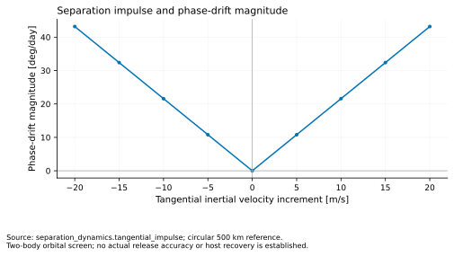

# spacecraft-separation-dynamics



Dependency-free, first-order calculations for separation impulse, host recoil, tip-off,
and a symmetric internal mass move. Each function exposes its narrow physical boundary.

```python
from separation_dynamics import host_recoil, tangential_impulse
print(host_recoil(10, 2, 1000))
print(tangential_impulse(500_000, 10))
```

Regenerate the chart with `python tools/generate_figure.py`; run tests with
`python -m unittest discover -s tests -v`.
This focused library complements the broader [VOLLEY](https://github.com/aaaaaaaaaaaavm/VOLLEY)
programme without duplicating its architecture.
